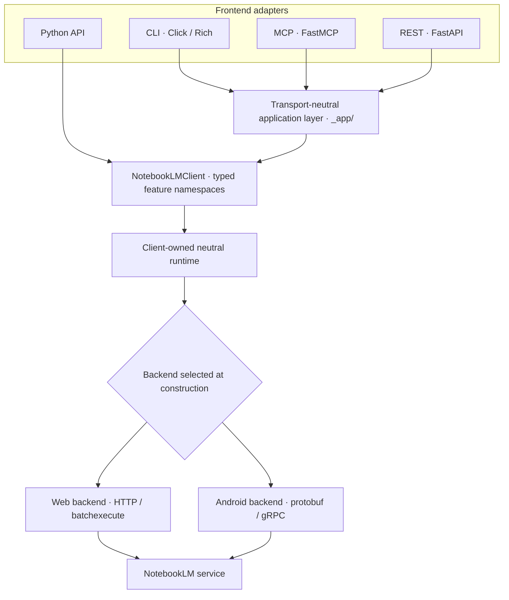
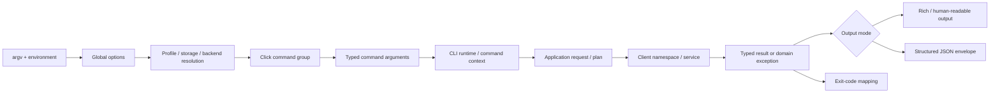
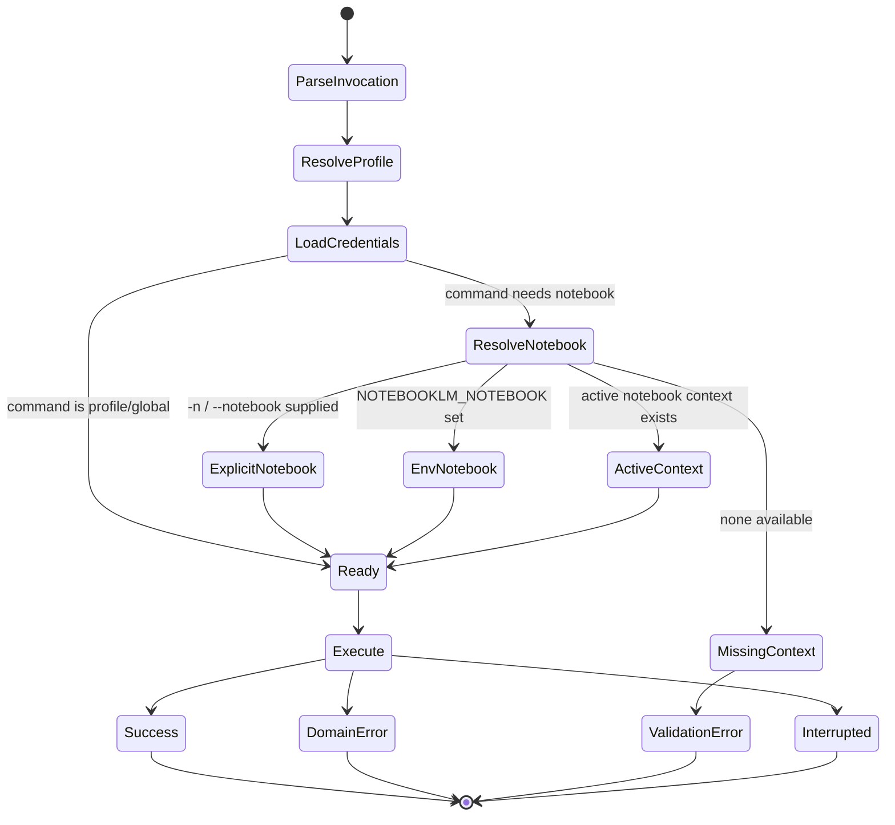
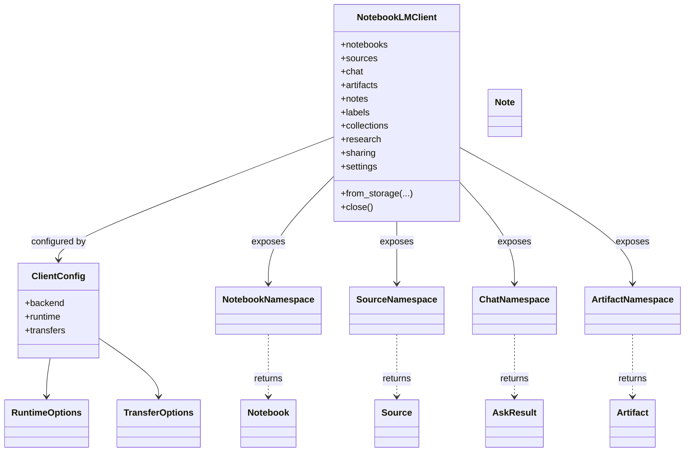
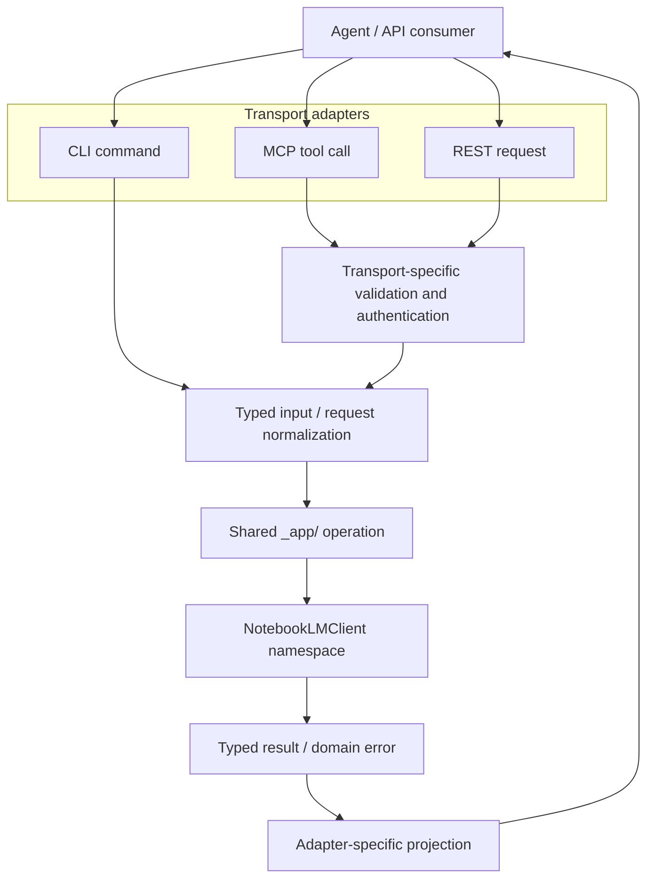
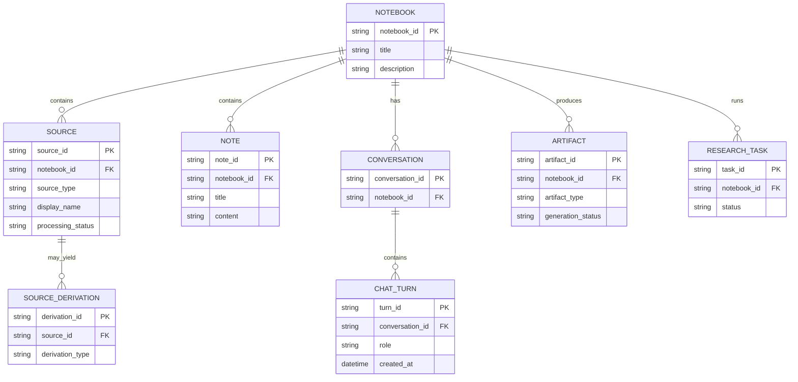
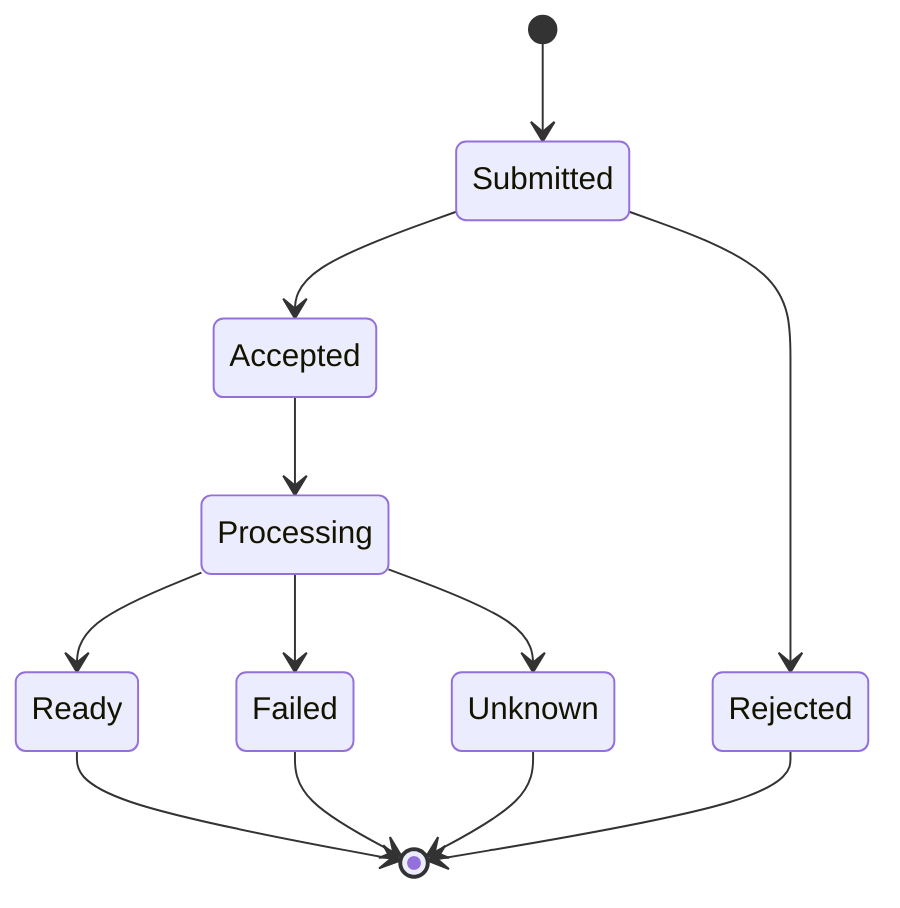
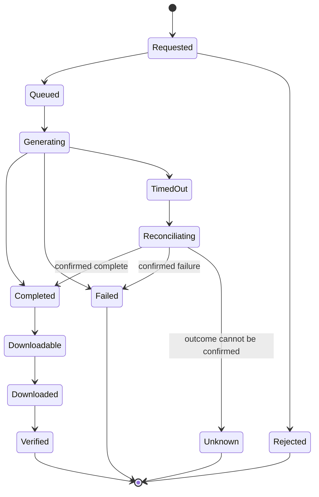
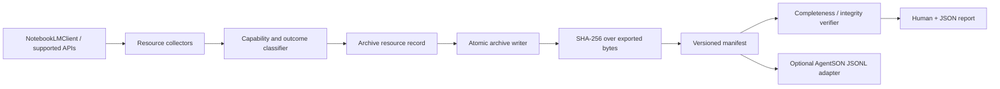

# Architecture, state diagrams and data models

**Status:** Current-state model based on the fork's inherited code and reference documentation, with proposed archive extensions marked separately.

This document is a companion to [the upstream architecture guide](../architecture.md), [CLI reference](../cli-reference.md), [Python API reference](../python-api.md), [MCP guide](../mcp-guide.md) and [diagram catalogue](../diagrams/README.md). It does not replace those detailed references.

## 1. Runtime boundaries

The current architecture separates frontends from transport-neutral application operations and backend-specific transport implementations:

**Boundary rules from the inherited architecture:**
- CLI, MCP and REST are adapters; they should not own raw RPC payload construction.
- The `_app/` layer owns transport-neutral plans, resolution, waits, retries, status projection and error classification.
- `NotebookLMClient` exposes typed feature namespaces and public data contracts.
- Backend choice is made at construction. Web and Android are separate transport assemblies.
- MCP and REST are optional/experimental extras; their public surface is not covered by the same compatibility guarantees as the core Python API.

## 2. CLI data model

The CLI is a command grammar and presentation adapter. It resolves command-line input and context, invokes shared operations, then renders human or JSON output.

### CLI input and output entities

| Entity | Meaning | Examples / notes |
|---|---|---|
| Invocation | One process execution | `notebooklm [GLOBAL OPTIONS] COMMAND` |
| Global options | Cross-command configuration | `--profile`, `--storage`, `--backend`, `--json`, verbosity |
| Profile | Named credential/configuration context | Default profile or named profile |
| Notebook context | Target notebook resolution | Explicit `-n`, `NOTEBOOKLM_NOTEBOOK`, active context |
| Command | User-intent operation | `source add`, `ask`, `generate audio`, `download report` |
| Request / plan | Transport-neutral operation input | Validated identifiers and operation parameters |
| Result | Typed service outcome | Notebook, source, answer, artifact status, path, etc. |
| Error envelope | Stable machine-readable failure category | JSON `code`, message and relevant details |
| Process status | Shell control-flow signal | 0, 1, 2, 130; command-specific documented exceptions |

### Context resolution

The exact option precedence and command-specific exceptions remain governed by the CLI reference and implementation. Do not treat this high-level diagram as a substitute for those rules.

## 3. Python API data model

The primary public entry point is `NotebookLMClient`. It owns typed namespaces, configuration, lifecycle and backend assembly.

The class diagram is intentionally conceptual: namespace names and resource types are grounded in the public package, but method signatures and all fields belong in the versioned API reference and typed source definitions.

## 4. MCP and REST mapping

| Surface | Contract shape | Status / boundary |
|---|---|---|
| Python API | Async methods, typed options, dataclasses and exceptions | Primary library integration surface |
| CLI | Command grammar, human output, optional structured JSON and process exit codes | Shell/automation adapter |
| MCP | Tool names, JSON-like arguments and tool results | Optional extra; explicitly experimental |
| REST | HTTP methods/routes, JSON bodies, bearer authentication and HTTP status | Optional extra; explicitly experimental |

The MCP guide currently documents 38 tools. Treat that count as a versioned snapshot, not a permanent contract. REST's OpenAPI/schema endpoints are disabled by default in the inherited server implementation; consult the route modules and server security boundary before relying on endpoint discovery.

## 5. Resource and state models

This is a conceptual domain model, not a claim that every relationship is persisted by Google exactly as drawn. IDs, field availability and resource lifecycles are backend/service-dependent.

## 6. State diagrams for resource operations

### Source processing

### Generated artifact

The `Unknown` and reconciliation states are important for non-idempotent operations: a timeout does not necessarily mean the remote operation did not happen. Consult the inherited operation-lifetime and unconfirmed-write contracts before implementing retries.

## 7. Proposed archive extension boundary

The archive/provenance layer should be an optional consumer of the existing client rather than a rewrite of its transport internals:

The extension must not claim original-file recovery when only indexed text is available. Detailed proposed fields and status semantics are in [archive and provenance model](./archive-provenance-model.md).
