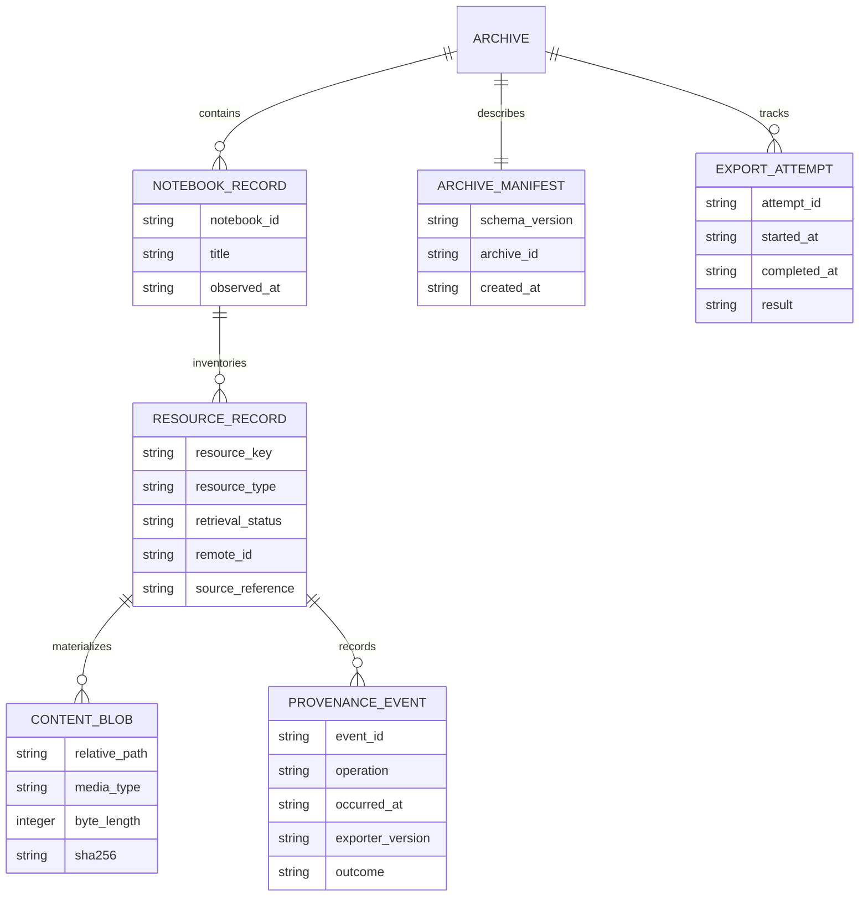

# Archive and provenance data model

**Status:** Proposed design. This document does not assert that the archive/export feature already exists.

## 1. Resource classes must remain distinct

An archive must not collapse different NotebookLM representations into one generic "source" object.

| Resource class | What it represents | Important limitation |
|---|---|---|
| Original upload | Exact bytes initially supplied by a user | May not be retrievable from NotebookLM after upload |
| Indexed/extracted content | Text or content representation exposed by NotebookLM | Not necessarily byte-identical to the original |
| Source metadata | NotebookLM's description, source ID/type/status and available metadata | May omit fields or change over time |
| User note | User-authored or saved note content | Must not be confused with model-generated summary |
| Conversation | Chat turns and associated metadata | History may be paginated or only partially exposed |
| Generated artifact | Audio, video, slide deck, report, quiz, flashcards, mind map, infographic, table, etc. | Generation status and download availability are separate |
| Research task | A research operation and its status/results | May be asynchronous and require polling |

## 2. Archive entity model



## 3. Resource retrieval status

Use a finite status vocabulary and retain error context. A resource should have one final outcome per export attempt.

| Status | Meaning |
|---|---|
| `available` | Content or metadata was retrieved and recorded |
| `unsupported` | The current exporter has no supported retrieval method for this resource |
| `not_authorized` | The service or account denied access |
| `not_found` | The service explicitly reported that the referenced resource does not exist |
| `failed` | Retrieval was attempted but failed |
| `not_tested` | Capability has not been verified for this resource/backend/account combination |
| `unknown` | The outcome cannot safely be determined |

Do not map an empty response, timeout or missing endpoint to `not_found` unless the service contract establishes that meaning.

## 4. Manifest example

The following is an illustrative schema instance, not a committed schema validator or a guarantee of current service fields:

```json
{
  "schema_version": "0.1.0",
  "archive_id": "archive-2026-000001",
  "created_at": "2026-11-07T00:00:00Z",
  "exporter": {
    "name": "notebooklm-py-fork-archive",
    "version": "0.1.0",
    "upstream_repository": "https://github.com/teng-lin/notebooklm-py",
    "upstream_commit": "record-the-exact-commit-used"
  },
  "notebook": {
    "remote_id": "redacted-or-user-selected-id",
    "title": "Example research notebook"
  },
  "resources": [
    {
      "resource_key": "source:example-source-id:indexed-text",
      "resource_type": "indexed_text",
      "remote_id": "example-source-id",
      "retrieval_status": "available",
      "retrieved_at": "2026-11-07T00:00:00Z",
      "media_type": "text/markdown",
      "path": "notebooks/example/sources/example-source-id/indexed-text.md",
      "byte_length": 1234,
      "sha256": "sha256-of-the-exact-exported-bytes",
      "provenance": {
        "method": "document-the-actual-api-or-library-method",
        "backend": "web",
        "evidence_ref": "optional-local-evidence-reference"
      }
    },
    {
      "resource_key": "source:example-source-id:original-upload",
      "resource_type": "original_upload",
      "remote_id": "example-source-id",
      "retrieval_status": "unsupported",
      "reason": "No verified original-binary retrieval method is available"
    }
  ],
  "summary": {
    "available": 1,
    "unsupported": 1,
    "not_authorized": 0,
    "not_found": 0,
    "failed": 0,
    "not_tested": 0,
    "unknown": 0
  }
}
```

## 5. Integrity and completeness

- Compute SHA-256 over the exact bytes written, not over decoded/re-encoded text unless the canonical encoding is explicitly part of the format.
- Record byte length and media type alongside the digest.
- Use atomic writes and collision-safe paths; reject path traversal and unsafe symlink targets.
- Verification should classify files as matching, missing, changed, unexpected or unverifiable.
- Completeness is a comparison between observed inventory and export outcomes, not a claim that the exporter can see every remote object.
- A checksum establishes byte integrity relative to the manifest. It does not establish authorship, ownership, consent, licensing or truth.

## 6. Privacy and security

Never archive authentication cookies, bearer tokens, OAuth refresh tokens, raw authorization headers or secret-bearing environment variables. Keep notebook content local by default. If optional event telemetry is introduced, make it opt-in, minimize payloads and redact content unless the user explicitly chooses otherwise.

## 7. Restore and portability classification

Every resource type should be classified as one of:

- `restorable`: a verified import/restore operation can recreate the resource.
- `reimportable`: a local copy can be re-added, but identity, sharing, history or generated state may differ.
- `metadata_only`: metadata can be preserved, but the remote object cannot be recreated.
- `not_restorable`: no supported recreation path is known.
- `unknown`: restore behaviour has not been verified.

An export is not a backup until restore behaviour has been tested and its limits documented.
